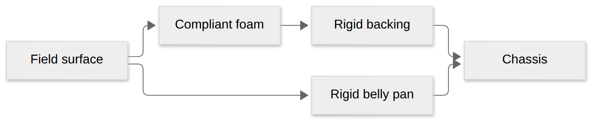

# Configurable chassis and pool-noodle contact

This is an uncalibrated numerical desktop model. `RobotContactConfig` is owned by
MecoSimulation; the season robot supplies its construction estimates through the
three-argument `CreateDriveSimulationAdapter` overload. The existing overload
retains rigid bumper contact. Compliance requires Full3D; the season retains its
legacy planar fallback.

## Start here

Trying to understand why the robot catches on a bump? Start with the foam, backing, and pan.

[Diagram source](visuals/contact-layers.mmd)

- Put your robot’s dimensions and material estimates in `RobotContactConfig`.
- Full3D models foam that compresses, plus a rigid backing and pan. Those rigid parts can still catch or high-center.
- Pressure, damping, and friction are estimates. A successful simulated crossing is not proof that the real robot will cross.
- The older adapter overload retains rigid contact. See [Jolt simulation models](jolt-simulation.md) for the physics boundary and [bump contact](bump-contact.md) for the earlier rigid study.

## Construction and frames

All configured heights reference unloaded carpet. The solid pan bottom starts at
2 inches with 1/8-inch thickness; its half-length/width are 0.3411 m. The bumper
outer half-length/width remain 0.43 m. Two 2.75-inch noodles are stacked on each
side, with a 0.25-inch bottom gap. The backing is 0.75-inch plywood, 5 inches
high, with its bottom flush with the foam. Those are library defaults; the season
uses the user-selected **0.5-inch flush foam and plywood floor gap**. Remaining
construction values are estimates, not measurements.
The 4-inch by 2-inch WCP X2i high-grip wheel geometry retains the existing module
locations, tire friction estimate 2.1, motor limits and ratios.

The pan and four plywood segments form one rigid compound on the existing robot
body. No mass is added. Compound geometric CoM is cancelled before applying the
configured CoM offset, preserving the declared origin and inertia. Changing pan
clearance changes its shape placement, not wheel support height, CoM, or pose
publication. Foam overlap queries never create bodies or rigid outer-foam contacts.
Front/rear noodles span the full width; side noodles terminate at their inner
edges to avoid overlapping corner volumes. Rounded noodle geometry replaces the
old rectangular outer foam shell in compliant mode.

A flush plywood bottom still strikes terrain at its configured clearance. Foam
compression cannot remove that rigid obstruction. A solid pan also permits
high-centering. The season acceptance requires reliable upright full-stick crossing; it does not
prove the unmeasured physical robot will cross.

Wheel support queries use the complete 4-inch by 2-inch cylinder (1 mm rounded
edge), rather than a vertical point ray: a tire meets a lip before its axle does.
The 10 mm query margin and 0.1 mm wheel penetration slop are numerical tolerances.
Jolt speculative contact distance is 1 mm and penetration slop 0.1 mm; its
20 mm defaults exceeded the bumper gap and thin pan. Dynamic robot hard shells
use linear-cast CCD at the unchanged 4 ms step. These settings also apply to the
legacy rigid comparison. Wheel acceleration supplies the opposite chassis
reaction torque, including airborne acceleration; tire force still acts at the
actual contact point. Tire deformation and individual spikes remain unmodeled.

## Foam response

Eight capsule queries run once per 4 ms step against static geometry only. Each
retains at most four patches, merging contacts within 10 mm with nearly matching
normals. Full projected noodle area (segment length times diameter) is shared
across retained patches so additional seam hits do not multiply stiffness.
This area approximation does not model contact-area growth or individual cells.

The provisional pressure curve is piecewise linear:

| Compression strain | Pressure (Pa) |
| --- | --- |
| 0 | 0 |
| 0.25 | 10000 |
| 0.50 | 35000 |
| 0.70 | 100000 |
| 0.80 | 250000 |

Compression strain is overlap depth divided by noodle diameter. The last positive
slope continues beyond 80%; damping ratio starts at 0.8. Patch stiffness follows
the curve tangent and projected area. Damping uses the effective contact mass.
Normal impulses are solved implicitly with the wheel-support constraints, clamped
to push only. Tangential shear is an implicit elastic layer using estimated G = E/2 (zero
Poisson ratio), bounded by the normal impulse and geometric-mean friction of
foam (0.65) and the opposing material. Plastic return dissipates sliding work.
Matched patches retain tangent displacement; separation and reset forget it.
Patch matching uses the same static body/capsule, normal dot above 0.95 and a
50 mm position window. Stiffness changes cannot increase stored energy or force.
This shear estimate is not measured noodle data.
The existing ramp material coefficient is unchanged. There is no extra lift,
airborne traction, chassis suspension or altered tire friction.

The fixed 24-iteration solve and fixed contact arrays bound storage and solver
work; the existing Jolt broad-phase query cost still depends on scene complexity.
Rigid pan/backing contacts run through Jolt after the custom wheel/foam solve,
so coupling with those hard contacts remains an operator-split approximation.
This changes physical contact response; it does not deform the displayed robot mesh.
No force-compression measurements were supplied. Foam hysteresis, permanent set,
cover tension, tread deformation, and dynamic-piece foam contacts are not modeled.

## Configuration and telemetry

Edit the season `RobotContacts()` factory to change construction and material
values; restart simulation to apply them. Dashboard values are read-only reports,
not runtime setters. Geometry is validated before creating the body. Nonfinite,
nonpositive dimensions, out-of-envelope backing/pan, and nonmonotonic curves fail
startup. Scene reset clears applied forces and foam state.

At 50 Hz, without the latency flag:

- `/Simulation/Contact/WheelNormalLoadsN`: four module loads in existing module order.
- `/Simulation/Contact/FoamCompressionM`: eight maximum overlap depths.
- `/Simulation/Contact/FoamNormalForcesN`: eight summed normal forces.
- `/Simulation/Contact/RigidContactsPanBacking`: pan and backing manifold counts
  for the most recent physics step, not forces or unique impacts.

Noodle order is negative-X lower/upper, positive-X lower/upper, negative-Y
lower/upper, positive-Y lower/upper. `/Diagnostics/Drive/AzimuthLoad` is also now
available without the latency flag. `FieldSimulation/*` reports construction,
material curve, wheel dimensions, and tire friction once during initialization.

## Checks and local packaging

`ctest` includes distinct robot-contact cases: independent clearance and
flat-ground support; progressive/damped/separated foam response and impact energy;
rigid backing/pan blocking with static-only seam queries; finite-wheel lip support;
airborne wheel/chassis momentum conservation; and compliant shear/reset/separation.
The existing bump
scenario reports legacy and compliant runs separately, including complete
crossing, unloaded wheels, foam compression/force, and pan/backing contacts. The
selected half-inch flush configuration must cross upright from rest at a 5.24 m/s
command. The packaged joystick test repeats full-stick crossing and settling.

Run `simulation_benchmark --bumper-contact` from a Release CMake build. It compares
matched repeated pressing contact, including before/Jolt/after work, after warmup.
Targets are p99 below 4 ms and added p99 below 0.4 ms on the same host. These
measurements do not guarantee scheduler deadlines.

The release coordinate is `2026.0.11`. Release CI builds Linux and Windows
Debug/Release archives, links clean consumers, verifies deployed checksums and
repeats consumer checks against public Maven. For local Linux development,
`scripts/build_local_contact_package.sh` stages matching archives and headers;
that local build alone does not establish public release acceptance. Rebuild all
Simulation owners when public struct layouts change. No Jolt types escape public
headers and no MecoBase layout changes are required.
