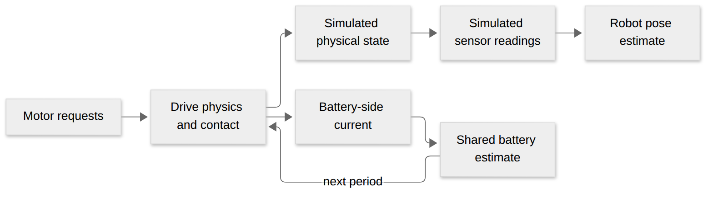

# Simulation basics

MecoSimulation supplies reusable desktop physics. A robot project supplies its own mass, dimensions, gearing, field setup, and game behavior.

[Diagram source](visuals/simulation-basics.mmd)

## Drive and contact

- The 3D model uses hard-mounted wheel contact. Supported wheels can produce modeled tire forces; an unsupported wheel has no ground traction.
- Steering load depends on the estimated contact patch and wheel load. It is an approximation, not a carpet measurement.
- Optional compliant contact models foam and rigid backing. The robot project supplies its construction assumptions.
- Physics truth and the pose estimated from sensors are separate. Neither is a measurement of a real robot.

Read [Jolt simulation models](jolt-simulation.md), [compliant contact](compliant-bumper-contact.md), and [DrivePhysics](../include/base/sim/DrivePhysics.h).

## Shared battery

- After each shared runtime period, `UpdateBatterySupply` estimates voltage from battery-side supply current. Plants consume that voltage in the next period.
- Defaults are 12 V open circuit and 20 mΩ resistance. The update is smoothed for numerical stability; it is not a measured battery time constant.
- This model does not include state of charge, regeneration, or branch losses.

See [BatterySupply.h](../adapters/wpilib-2026/include/meco/sim/BatterySupply.h). Robot code decides when to call it.

## Practice matches

The desktop [practice controller](practice-mode.md) publishes simulated Driver Station state from a profile supplied by the robot. The robot project chooses timings, game rules, and dashboard controls. It is not a field-management system or a scoring simulation.
